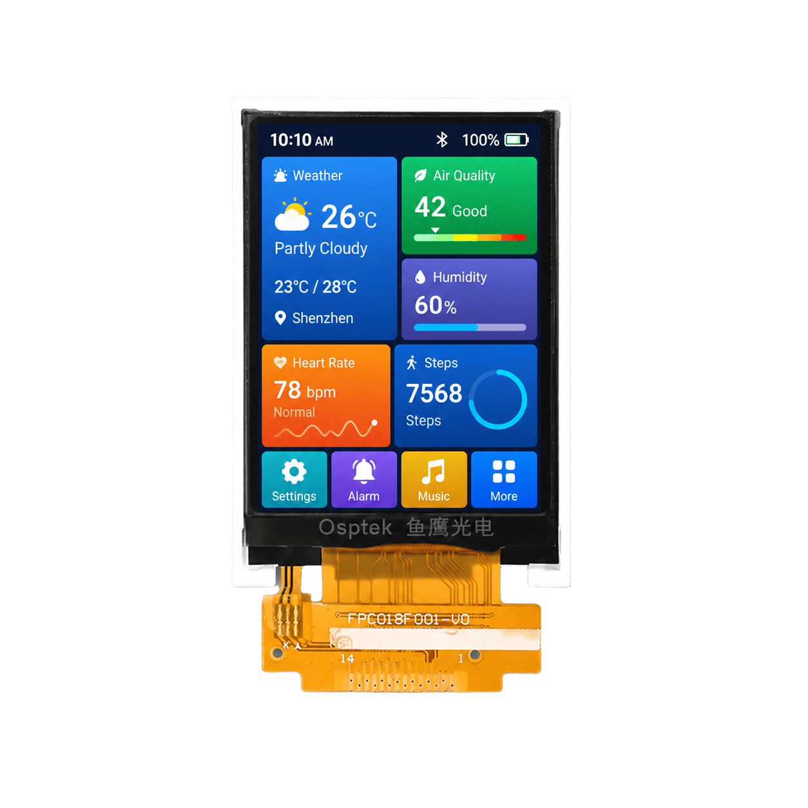

<p align="left"></p>

<h1 align="center">OSPTEK 1.77″ TFT Display 128×160 (YDP177F001-V1)</h1>

<p align="center"><b>TFT module · SPI · ST7735S</b></p>

<p align="center"><a href="./README.md">简体中文</a> | English · <a href="../../README_EN.md">Family index</a></p>

<p align="center">
  
  
</p>

<p align="center"></p>

## Contents

- [Specifications](#specifications)
- [Resources](#resources)
- [Repository layout](#repository-layout)
- [Buy](#buy)
- [Support](#support)

---

## Specifications

| Item | Spec |
| ---- | ---- |
| Size | 1.77 inch |
| Type | TFT |
| Resolution | 128×160 |
| Outline | 34.7 x 46.7 x 2.3 mm |
| Active area | 28.03 x 35.04 mm |
| Interface | SPI |
| Driver IC | ST7735S |
| Touch IC | — |

> Full outline, FPC definition, power, and timing follow the product datasheet / driver IC datasheet.

## Resources

| Category | File |
| ---- | ---- |
| Datasheet | [`ST_7735_S_V1_1_20111121_216e4c50b7.pdf`](./datasheets/ST_7735_S_V1_1_20111121_216e4c50b7.pdf) |
| Datasheet | [`YDP177F001-V1.pdf`](./datasheets/YDP177F001-V1.pdf) |
| Init code | [`1.77寸初始化CTC+ST7735S.c`](./code/1.77%E5%AF%B8%E5%88%9D%E5%A7%8B%E5%8C%96CTC%2BST7735S.c) |

## Repository layout

```text
display-tft-1.77inch-128x160/ # repo root (nav: ../../README_EN.md; sample projects under root examples/)
└── versions/
    └── YDP177F001-V1/        # full materials for this part number
        ├── README.md
        ├── README_EN.md
        ├── osptek.yml
        ├── images/
        ├── datasheets/       # product datasheet + driver/touch IC datasheets
        └── code/             # init reference code
```

## Buy

See the [repo home page](../../README_EN.md#where-to-buy).

## Support

See the [repo home page](../../README_EN.md#support).

---

<p align="center"><sub>© 2026 OSPTEK · Materials in this repository are licensed under CC BY 4.0</sub></p>
